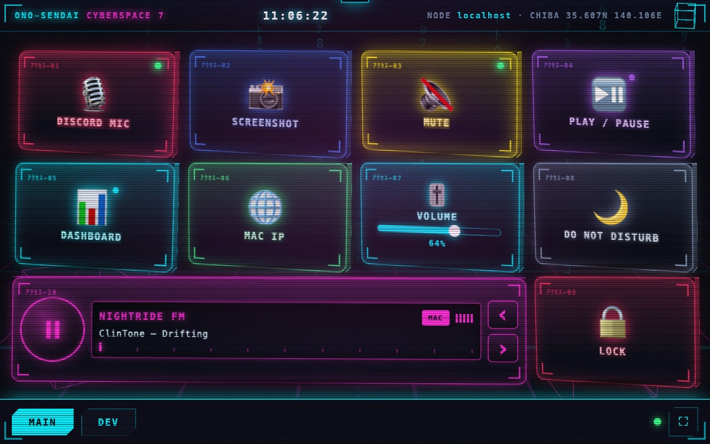

# TabDeck

> 🇬🇧 [English README](README.md) · 🇮🇹 Italiano (questa pagina)




*Screenshot fatto con un browser headless a 960×600 (16:10), con pulsanti dimostrativi, non su un tablet vero. Altri nel [README inglese](README.md).*
Un macro pad touch per il tablet (Lenovo Duet), configurato dal Mac. Un solo
processo Bun/TS, frontend vanilla, nessuna dipendenza e nessun build step.
Il progetto è pensato per **ridare vita a tablet vecchi o deboli**.

- **Pad** `http://<ip-del-mac>:8430/` — la griglia di pulsanti, da aprire sul tablet.
- **Editor** `http://localhost:8430/edit` — solo dal Mac. Crea, sposta, programma e prova i pulsanti.

Gira **nativo sul Mac, non in Docker**: le azioni (`osascript`, `open`, shell) devono
agire sul Mac, non dentro un container.

## Avvio

```bash
cd tabdeck
bun start          # oppure: bun run dev (riavvia a ogni modifica del server)
```

Sul tablet apri l'indirizzo mostrato in alto a destra nell'editor (clic = copia).
A tutto schermo: pulsante ⛶ in basso a destra.

Variabili: `PORT` (8430), `HOST` (0.0.0.0), `DATA_DIR` (`./data`), `KIOSK_URL` (dove porta il
pulsante dashboard del pad; predefinito `http://<stesso host>:8420/kiosk`, `off` lo nasconde,
si accettano solo URL `http(s)://`), `RADIO_PLAYER` (vedi Radio).

Nella barra in basso del pad: schede delle pagine, puntino di connessione, **↻ ricarica**
(utile su un tablet kiosk senza barra del browser), **▦ dashboard** (apre il kiosk della
dashboard in una tab dedicata, riusata la volta dopo, senza digitare indirizzi sul tablet) e
**⛶ schermo intero**.

### Lingua

Il default è l'inglese. Per l'italiano apri `/?lang=it` (la scelta viene ricordata nel
browser); senza scelta si usa la lingua del browser, se disponibile. L'editor ha un
selettore di lingua. I messaggi del server (errori, risultati) sono solo in inglese.

### Sempre acceso (launchd)

Compose non è adatto: il container è una VM Linux e non può eseguire `osascript`/`open`
sul Mac. Si usa un LaunchAgent, che parte al login e viene rilanciato se cade:

```bash
scripts/launchd.sh install     # status | uninstall
```

Log in `~/Library/Logs/tabdeck.log`. Il percorso di `bun` è fissato all'installazione
(versione inclusa): se mise lo aggiorna e rimuove la vecchia, rilancia `install`.
Il permesso Accessibilità va dato al binario `bun` (non al Terminale) perché il processo
lo lancia launchd.

## Cosa può fare un pulsante

Un pulsante è una **lista ordinata di azioni**; si ferma al primo errore
(salvo «continua se fallisce», vedi sotto).

| Azione | Cosa fa | Note |
|---|---|---|
| Comando shell | `zsh -lc "<cmd>"`, cartella e timeout (default 30 s, max 300) | Il timeout uccide anche i figli. Un `cmd &` in background non blocca il pulsante. `$PAD_BUTTON` = id del pulsante |
| AppleScript | `osascript` da stdin (timeout 30 s) | |
| Azione Mac | Azione del catalogo (vedi sotto), genera l'AppleScript | Alcune richiedono *Accessibilità* |
| Scorciatoia | `cmd+shift+4`, `ctrl+left`, `f5`… Un modificatore da solo (`opt`, `cmd+shift`) viene premuto e rilasciato. Con **Pressioni** (1–10) e un intervallo (ms) per ripetizioni rapide, per esempio il doppio tocco di Option | Pulsante **Registra** nell'editor. Serve *Accessibilità* |
| Scrivi testo | Digita il testo (a-capo = Invio) | Serve *Accessibilità* |
| Apri | URL, file, cartella e/o app (`open`) | |
| HTTP | GET/POST/PUT/PATCH/DELETE con header e body, timeout 10 s | Solo `http(s)://` |
| Click del mouse (`click`) | Sinistro/destro/centrale, 1–3 click (doppio click = 2), dove si trova il puntatore o a coordinate fisse | Serve *Accessibilità*. Le cifre in `keys` sono inviate come tasti della riga in alto |
| Pausa | 0–60000 ms | Fra due azioni |
| Condizione (`when`) | Comando shell di guardia (timeout 10 s) | Exit 0 = continua, exit 1 = la catena finisce in silenzio (nessun errore), altro = errore |

Opzioni del pulsante: **conferma** (il primo tocco arma per 3 s, il secondo esegue) e
**mostra output** (l'output compare come avviso sul tablet; gli errori si vedono sempre).

### Azioni Mac (catalogo)

Modelli tipizzati che generano AppleScript; gli argomenti sono validati ed escapati sul
server (`lib/macos.ts`). L'editor mostra il catalogo (`GET /api/actions`) e può anche
mostrare lo script generato (`POST /api/macscript`).

| Gruppo | Azioni |
|---|---|
| `music` | `music.playpause`, `music.next`, `music.previous`, `music.volume` (livello 0–100) |
| `spotify` | `spotify.playpause`, `spotify.next`, `spotify.previous`, `spotify.volume` (livello 0–100) |
| `system` | `system.volume` (0–100), `system.volumeStep` (delta −100…100), `system.mute` (toggle/on/off), `system.notify` (titolo, messaggio), `system.darkMode` (toggle/dark/light), `system.sleepDisplay`, `system.lock` |
| `app` | `app.open`, `app.quit`, `app.hide` (nome app) |
| `ui` | `ui.menu` (app, menu, voce di menu) |
| `window` | `window.move` (x, y), `window.resize` (larghezza, altezza), `window.fullscreen` |

`ui.*`, `app.hide`, `window.*`, `system.darkMode` e `system.lock` passano da System Events
e quindi richiedono il permesso *Accessibilità*.

### Condizioni, errori ignorati e output fra azioni

- **`when`**: una guardia shell. Se vale «falso» (exit 1) la catena si ferma senza errore:
  il risultato resta `ok` e porta `stopped: true`.
- **Continua se fallisce** (`continueOnError`, su qualunque azione tranne `when`): se l'azione
  fallisce la catena prosegue; il passo è marcato `ignored`.
- **`$PAD_OUT`**: l'output dell'azione precedente, visibile alle azioni shell, AppleScript, Azione
  Mac e `when` come variabile d'ambiente (in AppleScript: `system attribute "PAD_OUT"`).
  Insieme a `$PAD_BUTTON` (id del pulsante) e, per i cursori, `$PAD_VALUE`.

### Pressione lunga, LED, cursori, pagine

- **Pressione lunga:** tenendo premuto ~0,5 s si eseguono le azioni «Pressione lunga» al posto del
  tocco (senza conferma: è già un gesto deliberato). Si vede dal **pallino sull'icona**; mentre
  tieni premuto una barra si riempie. Solo i pulsanti che hanno azioni di pressione lunga la offrono.
- **LED di stato:** un comando shell per pulsante, controllato ~ogni 2,5 s e dopo ogni azione.
  Exit 0 = acceso (il tasto si illumina e il LED in alto a destra diventa verde). Timeout (3 s) =
  stato ignoto, il LED non cambia. Il tablet non vede mai il comando, solo se il LED esiste.
- **Cursore** (tipo «Cursore» nell'editor): trascini lungo la traccia, il valore intero 0–100 arriva
  ai comandi in `$PAD_VALUE` (variabile d'ambiente, mai interpolata nella stringa) ~10 volte al
  secondo. «Leggi valore» deve stampare un numero 0–100: il cursore si riallinea al valore reale del
  Mac, ma non scavalca il dito né il tuo ultimo gesto (1,5 s).
- **Pagine:** swipe orizzontale o tab; la plancia ruota «a cubo». Lo swipe non agisce sui cursori.
  Con `prefers-reduced-motion` l'animazione è disattivata.

**Permesso Accessibilità** (scorciatoie, testo e azioni Mac via System Events): Impostazioni di
Sistema → Privacy e sicurezza → Accessibilità → aggiungi il programma che lancia `bun`
(es. Terminale). Senza, il pulsante fallisce e l'avviso lo spiega.


### Radio (autoradio)

Un widget (da 4×2 unità, cioè largo due tile) per le stazioni incluse: [Nightride FM](https://nightride.fm)
(11 stazioni synthwave/cyberpunk) e Virgin Radio: manopola play/pausa, display LCD con stazione e brano in onda, ‹ › per cambiare
stazione, scala di sintonia ed equalizzatore. Suona **sul Mac per impostazione predefinita**
(il server lancia `mpv`, o `ffplay`, cercati in `/opt/homebrew/bin`, `/usr/local/bin` o `PATH`;
si può forzare con `RADIO_PLAYER="comando argomenti"`, l'URL dello stream viene aggiunto in
coda); l'interruttore **MAC/TAB** sul widget la sposta sull'altoparlante del tablet (un
semplice `<audio>`, MP3). Stazione e uscita le ricorda il server in `data/radio.json`, così
tutti i tablet concordano. Continua a suonare cambiando pagina, uno stream caduto si riconnette
(dopo 5 fallimenti rapidi di fila mostra «NESSUN SEGNALE») e un player rimasto orfano dopo un
server ucciso viene fermato al riavvio successivo. Una sola radio per pad. I titoli arrivano dal
feed pubblico `/meta` di Nightride, letto dal browser. Gli stream sono di Nightride FM: il
progetto non è affiliato, quindi sostieni la stazione.

### Tile stazione (1 cella)

Un tasto play/stop per una sola stazione, per esempio **Virgin Radio** (lo stream AAC pubblico
del suo stesso player web, `icecast.unitedradio.it/Virgin.aac`; non pubblica il titolo del brano,
il widget mostra «IN ONDA»). Un tocco la avvia, un secondo la ferma; un altro tile o il widget
cambiano stazione. Si accende (affondato, LED verde) mentre suona e ha lo stesso badge
**MAC/TAB**: tutti i tile radio condividono un solo player e un'unica uscita. Le stazioni sono
le 11 di Nightride FM più Virgin Radio (`lib/stations.ts`).

### Griglia a quarti di tile

Ogni tasto si può ridimensionare, fino a un quarto di un tile classico. La griglia è misurata
in *unità* (un tile classico è 2×2): nell'editor trascina la maniglia d'angolo del tasto
selezionato oppure usa i pulsanti della sezione Dimensione. Minimi: tasto/stazione 1×1,
cursore 2×1, visualizzatore 2×1, radio 4×2. I tasti che diventano piccoli nascondono
l'etichetta (container query) invece di traboccare. Un pad salvato da una versione precedente
viene migrato al primo avvio con la stessa disposizione, e l'originale resta in
`data/pad.json.v1.bak`.

### Tile visualizzatore (audio di sistema)

Lo spettro di tutto ciò che il Mac sta riproducendo (qualsiasi app), disegnato sul tablet come
nei vecchi visualizzatori dei lettori multimediali: 32 barre con i picchi che scendono,
ridimensionabile, se ne possono mettere più d'uno. `tools/sysaudio.swift` cattura l'uscita di
sistema con un *process tap* di Core Audio (nessun driver audio virtuale) e fa una FFT; il
server lo compila al primo uso (servono gli Xcode Command Line Tools) e lo avvia solo mentre un
tablet mostra il tile, fermandolo pochi secondi dopo che l'ultimo spettatore se n'è andato.
**macOS chiede una volta la «Registrazione audio di sistema»** per il processo che esegue il
server; se non si sente nulla il tile scrive «NESSUN AUDIO (o consenti la Registrazione audio di
sistema)», perché silenzio e permesso negato sono indistinguibili. `VIZ_HELPER="comando"`
sostituisce l'helper (per esempio `tools/sysaudio --test-tone` per un segnale dimostrativo).

## Modello di sicurezza

Il server ascolta sulla LAN, e un pulsante può eseguire comandi sul Mac. Quindi:

- Il tablet può **solo premere pulsanti già definiti**: `GET /api/pad` non contiene mai i
  comandi, `POST /api/run/<id>` esegue solo ciò che sta in `data/pad.json`.
- `POST /api/radio` (il widget radio) è aperto al pad come le rotte di pressione, ma accetta
  solo una stazione da una lista fissa di 12 nomi e un'uscita (`mac`/`tablet`): non può far
  aprire al server un URL qualsiasi né eseguire altro.
- **Editor, salvataggio, prova e catalogo azioni** (`/edit`, `/api/config`, `/api/test`,
  `/api/actions`, `/api/macscript`) rispondono solo se la connessione parte dal Mac stesso
  (loopback o uno dei suoi IP) **e** l'header `Host` è `localhost` o un IP del Mac (blocca il
  DNS rebinding). Dal Duet o da un altro dispositivo: 403.
- Le richieste POST/PUT con `Origin` di un altro sito sono rifiutate (CSRF).
- **Non c'è autenticazione sul pad**: chiunque sia sulla tua LAN può premere i pulsanti.
  Per i pulsanti pericolosi usa *conferma*; se la rete non è fidata, mettici davanti
  un firewall o dimmelo e aggiungiamo un PIN.

La prima volta macOS chiede se `bun` può accettare connessioni in entrata: concedi.

## Dati

`data/pad.json` è la sola fonte di verità (gitignored; alla prima accensione contiene
un pad d'esempio con azioni innocue). Ogni salvataggio è atomico e tiene la copia
precedente in `pad.json.bak`. Se il file è invalido il server non parte e non lo
sovrascrive. Lo puoi anche modificare a mano: il tablet si aggiorna da solo (polling
ogni 2,5 s su `/api/rev`, la revisione cambia a ogni salvataggio dall'editor).

## Struttura

```
server.ts          Bun.serve: routing, guardie, limiti
lib/config.ts      schema, validazione, seed, store atomico
lib/run.ts         esecuzione dei passi (timeout, albero di processi, output)
lib/macos.ts       catalogo delle azioni Mac (AppleScript generato)
lib/keys.ts        "cmd+shift+4" → AppleScript System Events
lib/guard.ts       loopback/Host/Origin
lib/state.ts       stato dei LED
lib/radio.ts       riproduttore radio sul Mac (mpv/ffplay), lista chiusa di stazioni
lib/stations.ts    lista chiusa degli stream radio
lib/viz.ts         avvia l'helper audio e distribuisce gli spettri (SSE)
tools/sysaudio.swift  cattura dell'audio di sistema + FFT
public/pad.*       pad per il tablet
public/edit.*      editor
public/common.js   DOM helper + tile condiviso pad/editor
public/i18n.js     traduzioni (en/it)
tests/             bun test
```

## Limiti noti

- Su `http://IP-LAN` Chrome non espone il Wake Lock (serve https/localhost): per non far
  spegnere lo schermo del Duet regola il blocco schermo di ChromeOS.
- Se il Mac va in stop il pad segnala il puntino rosso in basso e riprova ogni 5 s.
- Un solo editor alla volta: l'ultimo salvataggio vince.
- Radio: i titoli e l'ascolto sul tablet richiedono che il tablet raggiunga internet; per ascoltarla
  sul Mac serve [mpv](https://mpv.io) o ffplay (`brew install mpv`). Non provata sul Duet.
