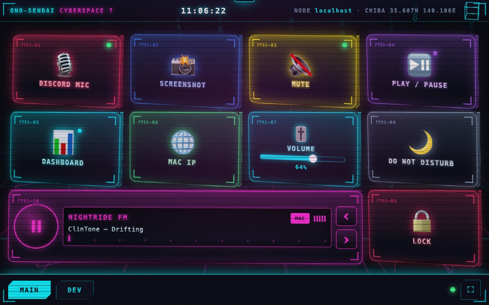
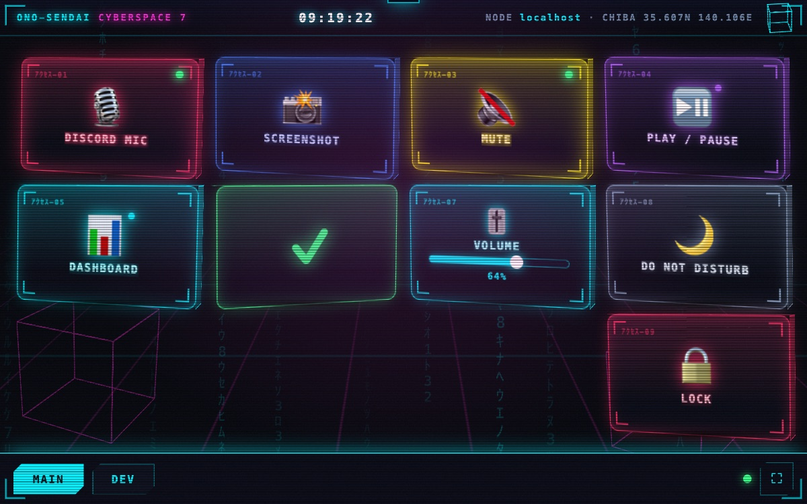
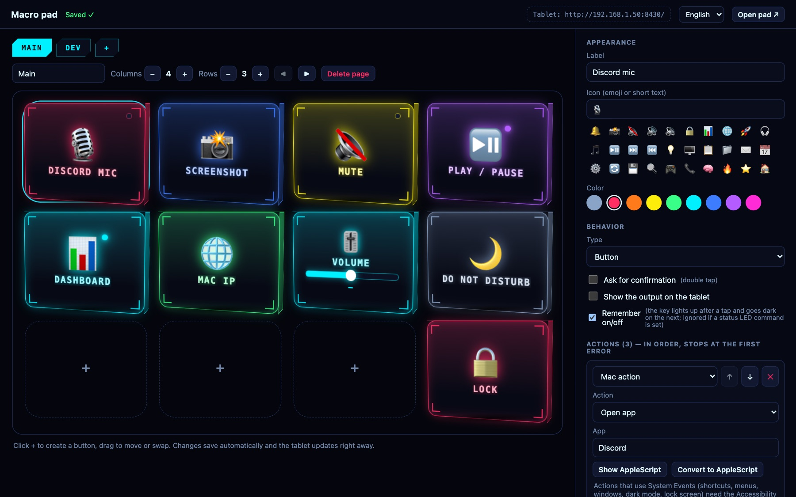

# TabDeck

> 🇬🇧 English · 🇮🇹 [Italiano](README.it.md)

**Turn an old or weak tablet into a macro pad for your Mac.** A Stream Deck made from the tablet in your drawer.

A touch grid of buttons that runs shortcuts, shell commands, AppleScript, URLs and
HTTP calls on your Mac. One Bun/TypeScript process, vanilla JS, no build step, no
dependencies.

- **Pad** `http://<mac-ip>:8430/` — the button grid; open it on the tablet.
- **Editor** `http://localhost:8430/edit` — Mac only. Create, move, program and test buttons.

The project is early. The author runs it on a Lenovo Duet Chromebook.



<details>
<summary>More screenshots</summary>

A key flips to show the result of the press (here a success):



The editor, on the Mac:



</details>

*Screenshots were taken with a headless browser on a 960×600 (16:10) viewport, using demo buttons, not on a real tablet.*

## Why

Old Chromebooks and 4 GB Android/ChromeOS tablets are too slow for most "dashboard"
web apps, but they make fine macro pads. This one is built to stay light on them:

- No build step, no framework, **zero dependencies** (`package.json` has none).
- The pad page is about **39 KB uncompressed** in total: `pad.html`, `pad.css`,
  `pad-deco.css`, `pad.js`, `pad-deco.js`, `common.js`, `i18n.js` plus the two small pad
  locale files (measured with `wc -c`: 38,957 bytes; 14,608 bytes with each file gzipped on its own, `gzip -9`).
- Animations only use `transform` and `opacity`; no blur and no `backdrop-filter`.
  `prefers-reduced-motion` turns the page transition off.
- The tablet only displays buttons and sends presses; everything runs on the Mac.

## Quick start

Requires [Bun](https://bun.sh) on a Mac.

```bash
git clone https://github.com/tcsenpai/tabdeck
cd tabdeck
bun start          # or: bun run dev (restarts on server changes)
```

Open the address shown at the top right of the editor on the tablet (click = copy).
Fullscreen: the ⛶ button at the bottom right.

Environment variables: `PORT` (8430), `HOST` (0.0.0.0), `DATA_DIR` (`./data`),
`KIOSK_URL` (where the pad's dashboard button goes; default `http://<same host>:8420/kiosk`,
`off` hides the button, only `http(s)://` values are accepted), `RADIO_PLAYER` (see Radio).

The first time, macOS asks whether `bun` may accept incoming connections: allow it.

### Always on (launchd)

Docker/Compose does not fit: a container is a Linux VM and cannot run `osascript` or
`open` on the Mac, and the whole point is to act on the Mac. Use a LaunchAgent instead;
it starts at login and is restarted if it dies:

```bash
scripts/launchd.sh install     # status | uninstall
```

Log: `~/Library/Logs/tabdeck.log`. The path to `bun` is fixed at install time
(version included): if your version manager updates it and removes the old one, run
`install` again. Grant the Accessibility permission to the `bun` binary (not the
Terminal), because launchd starts the process.

## Features

- **Grid and pages:** swipe horizontally or use the tabs; the board rotates like a cube.
  Swipe does not act on faders.
- **Bottom bar:** page tabs, the connection dot, **↻ reload** (handy on a kiosk tablet with no
  browser chrome), **▦ dashboard** (opens the dashboard kiosk in its own tab, reused next time,
  so nobody types an address on the tablet) and **⛶ fullscreen**.
- **Buttons with step chains:** a button is an ordered list of steps; it stops at the
  first error (unless the step has `continueOnError`).
- **Confirm** option: the first tap arms the button for 3 s, the second runs it.
  **Show output** option: the output appears as a toast on the tablet (errors always do).
- **Long press:** holding ~0.55 s runs the button's "long press" steps instead of the tap
  (no confirm: it is already a deliberate gesture). A **dot on the icon** shows that a
  button has one, and a bar fills while you hold.
- **LED state:** one shell command per button, polled about every 2.5 s and after each
  action. Exit 0 = on (the key lights up). Timeout (3 s) = unknown, the LED does not change.
  The tablet never sees the command, only whether the LED exists.
- **Remember on/off (latching):** for state the Mac cannot report (e.g. a Discord mic mute you
  toggle with a hotkey), tick *Remember on/off*. Each tap that completes (an "only if" guard that
  stops the chain does not count) flips the key between on and off: on = sunk in with a green LED.
  Stored in `data/toggles.json`, survives restarts. It does not see changes made elsewhere: if
  you toggle the mic by hand it will drift, and a button with a status-LED command uses that instead.
- **Faders:** drag along the track; the integer value 0–100 reaches your commands in
  `$PAD_VALUE` (an environment variable, never interpolated into the string) about 10
  times per second. A "read value" command must print a number 0–100; the fader then
  follows the Mac's real value, without overriding your finger or your last gesture (1.5 s).
- **Radio (car stereo):** a widget (from 4×2 units, two tiles wide) for the built-in stations:
  [Nightride FM](https://nightride.fm) (11 synthwave/cyberpunk) and Virgin Radio. It has a
  play/pause knob, LCD with station and the track on
  air, ‹ › to change station, a tuner scale and an equalizer. It plays **on the Mac by
  default** (the server runs `mpv`, or `ffplay`, found in `/opt/homebrew/bin`, `/usr/local/bin`
  or `PATH`; override with `RADIO_PLAYER="cmd args"`, the stream URL is appended); the **MAC/TAB**
  switch on the widget moves it to the tablet's own speaker (a plain `<audio>` element,
  MP3). Station and output are remembered by the server in `data/radio.json`, so every
  tablet agrees. It keeps playing when you change page, a dropped stream reconnects
  (after 5 quick failures in a row it shows "NO SIGNAL"), and a player left behind by a server
  that was killed is stopped at the next start. One radio per pad. Titles come from Nightride's
  public `/meta` feed, read by the browser. Streams belong to Nightride FM: this project is not
  affiliated with them, so please support the station.
- **Radio station tile (1 cell):** a play/stop key for one station, such as **Virgin Radio**
  (the public AAC stream of its own web player, `icecast.unitedradio.it/Virgin.aac`; no track
  title is published, the widget shows "LIVE"). One tap plays it, a second tap stops it, another
  tile or the widget switches station. It lights up (sunk in, green LED) while it plays and has the
  same **MAC/TAB** badge: all radio tiles share one player and one output. Station list: the 11
  Nightride FM stations plus Virgin Radio (`lib/stations.ts`).
- **Quarter-tile grid:** every key can be resized, down to a quarter of a classic tile. The grid
  is measured in *units* (a classic tile is 2×2); in the editor drag the corner handle of the
  selected key or use the Size steppers. Minimum sizes: key/station 1×1, fader 2×1, visualizer
  2×1, radio 4×2. Keys that get small hide their label (container queries) instead of
  overflowing. A pad saved by an earlier version is migrated on first start with the same
  layout, and the original is kept as `data/pad.json.v1.bak`.
- **Ambient glow:** soft "Ambilight" light at the pad's edges that follows the Mac's audio: bass at
  the bottom (magenta), mids at the sides (cyan), highs at the top (violet). Turn on "Offer the
  ambient glow" in the editor (nothing selected), then each tablet switches it on with the **✦**
  bar button (remembered per tablet). It shares the visualizer's audio capture and its **System
  Audio Recording** permission, and the helper runs only while a tablet has the glow on. It is
  drawn with static gradients whose opacity and scale are eased every frame (no blur filter),
  and sleeps while the Mac is silent.
- **Mic corners:** only the pad's four corners react to noise, like a mechanical keyboard's lights:
  each key click, tap or clap flashes the next corner, and the level adds a faint glow. Turn on
  "Offer the mic corners" in the editor; each tablet then cycles the **◩** bar button: off, **this
  tablet's microphone** (analysed in the browser, nothing is sent; browsers offer it
  only over https: the server also listens on **https://<mac-ip>:8443/** with a self-signed certificate generated into `data/` (`HTTPS_PORT=off` disables it); open that address once on the tablet, tap Advanced → Proceed, and use ◩ there),
  or **the Mac's microphone** (`tools/mic.swift`, compiled on first use, analysed on the Mac; the
  server streams two numbers per frame, never audio, and listens only while a tablet has it on;
  macOS asks once for the **Microphone** permission). It can run together with the ambient glow (which dims a little); the editor can also force the microphone source for every tablet.
  `MIC_HELPER="cmd args"` replaces the helper (e.g. `tools/mic --test-script`).
- **Overlay effects:** full-screen layers over the whole pad, picked in the editor (nothing selected →
  "Overlay effects"): **CRT** (curved-glass dark corners, flicker; the scanlines are the pad's own), **scan bar**, **glitch** (jumping
  strips and a colour flash), **film grain**, **heavy vignette**, **chromatic edges**. Pure CSS, only
  opacity/transform animate (no blur, no blend modes), touches pass through, `prefers-reduced-motion`
  stops the animations. On by default once chosen; each tablet can switch them off with the **▤** bar button.
- **Visualizer tile:** a spectrum of whatever the Mac is playing (any app), drawn on the tablet
  like the old media-player visualizations, in five styles you pick per tile (bars with falling peak caps, mirror, segmented blocks, wave, ring), resizable, several
  allowed. `tools/sysaudio.swift` captures the system output with a Core Audio *process tap*
  (no virtual audio driver) and runs an FFT; the server compiles it on first use (needs the Xcode
  Command Line Tools) and starts it only while a tablet is showing the tile, stopping it a few
  seconds after the last viewer leaves. **macOS asks once for "System Audio Recording"** for the
  process that runs the server; when nothing is heard the tile says "NO AUDIO (or allow System
  Audio Recording)" because silence and a denied permission look the same. `VIZ_HELPER="cmd args"`
  replaces the helper (e.g. `tools/sysaudio --test-tone` for a demo signal).
- **Per-app variants of a key:** "if Zoom is in front, this key becomes Mute". In a key's inspector
  add variants: an app (name or bundle id, exact or "contains", optionally narrowed by a browser URL
  or window title), and for it a label, icon, colour, confirmation, actions, long-press actions, or
  just **hide the key**. The first matching variant wins; with no match the key stays as it is.
  Any number of keys can react to the same app, so one spot on the pad can be a different button per
  app. The LED / remember-on-off state stays with the base key. The tablet is only told which variant
  to show, never the app: on a tap it says which variant it is showing and the Mac runs it only if
  that is still the one for the app in front (otherwise "The app in front changed", and the tile
  refreshes). Reuses the Automation permission of the automatic pages.
- **Decoration tiles:** display-only cyberpunk filler (kind "Decoration"): clock with date, scrolling
  hex dump, radar, heartbeat line, glitching banner (shows the tile's text), rack status lights.
  Touching them does nothing; they animate with transform/opacity only. Decorations start
  borderless.
- **Border on/off per tile:** every tile has a "Border" switch. Off removes the frame and 3D body and
  leaves just the content floating on the background (works for keys, faders, the radio, ...).
- **Radio favourites:** search the community directory [radio-browser.info](https://www.radio-browser.info)
  from the editor (nothing selected → "Radio favourites") and star the stations you like. They
  join the widget's ‹ › and the station tile's list. Only the id and name are saved; the stream
  URL is asked from the directory on every play (it also counts the click the directory asks
  for), checked to be a plain public `http(s)` URL, and used by the Mac player or the tablet's
  `<audio>`. The directory is run by one person with no guarantees: a station may be gone, and
  HLS (`.m3u8`) streams may not play in the tablet's browser (they do on the Mac). Up to 24.
- **Automatic pages:** the pad can follow the app in front on the Mac. In the editor (nothing
  selected → "Automatic pages") add rules: an app name or bundle id (exact or "contains"),
  optionally narrowed by a browser URL or window title, and the page to show; the first match
  wins. "Detect the app in front" fills a rule for you, 23 known apps are one click away, and
  for 9 of them ★ builds a starter page of default shortcuts. The pad moves only when the matched
  page *changes*, so a manual tap sticks until you switch app; the **⇆** bar button pauses it on
  one tablet. Matching is done on the Mac: the tablet only ever receives a page id. The first
  lookup makes macOS ask once to let the server control System Events (window titles) and, for
  URL rules, each browser.
- **Info bar:** up to six small chips in the pad's bottom bar (CPU, RAM, battery, disk, volume,
  uptime, load average, clock), chosen in the editor. Stock macOS tools only (no permission),
  cached 2 s on the server and polled every 5 s by the tablet while its tab is visible; a value
  over its threshold turns red. Hidden on narrow screens.
- **Macro recording:** every step list has a **● Record** button. Do the shortcuts and clicks on
  the Mac, press Stop, and they are appended as `keys`, `text`, `click` and `delay` steps. A
  listen-only event tap (`tools/recorder.swift`, compiled on first use) does the listening, for
  at most 120 s and only while you recorded; **macOS asks for "Input Monitoring"** for the
  process that runs the server. Everything you type meanwhile is recorded, passwords included.
  Click coordinates are screen positions. `RECORDER_HELPER="cmd args"` replaces the helper
  (e.g. `tools/recorder --test-script`, which never touches the keyboard).
- **Tablet profiles:** with several tablets, "Shown on" in the page settings limits a page to
  one tablet. Open the pad once as `/?profile=<id>` (the editor's "+ Tablet" creates the ids);
  the tablet remembers it. `/?profile=` clears it.
- **Install as an app (PWA):** the pad has a manifest and icons. Chrome offers a real install only
  in a secure context (https or localhost); over plain `http://<LAN-IP>` use ChromeOS's
  "Open as window" shortcut instead.
- **Mac actions catalog:** typed templates that generate AppleScript (see below).
- **`when` guard** and **`continueOnError`** (see below).
- **Language:** English or Italian (see below).

### Step types

| Step | What it does | Notes |
|---|---|---|
| `shell` | `zsh -lc "<cmd>"`, working directory and timeout (default 30 s, max 300) | The timeout kills child processes too. A background `cmd &` does not block the button |
| `applescript` | `osascript` from stdin (30 s timeout) | |
| `mac` | An action from the catalog below; generates the AppleScript | Some need *Accessibility* |
| `keys` | `cmd+shift+4`, `ctrl+left`, `f5`… A lone modifier (`opt`, `cmd+shift`) is tapped. Optional **Presses** (1–10) and a gap (ms) for quick repeats, e.g. a double tap of Option | **Record** button in the editor. Needs *Accessibility* |
| `text` | Types the text (newline = Return) | Needs *Accessibility* |
| `open` | URL, file, folder and/or app (`open`) | |
| `http` | GET/POST/PUT/PATCH/DELETE with headers and body, 10 s timeout | `http(s)://` only |
| `click` | Mouse click: left/right/middle, 1–3 clicks (double click = 2), at the pointer or at fixed screen coordinates | Needs *Accessibility*. Digits in `keys` are sent as top-row key codes |
| `delay` | 0–60000 ms | Between two steps |
| `when` | Shell guard (10 s timeout) | Exit 0 = continue, exit 1 = stop the chain silently, anything else = error |

### Mac actions

Defined in `lib/macos.ts`. Arguments are validated and escaped on the server. The
editor lists the catalog (`GET /api/actions`) and can show the generated AppleScript
(`POST /api/macscript`).

| Group | Actions |
|---|---|
| `music` | `music.playpause`, `music.next`, `music.previous`, `music.volume` (level 0–100) |
| `spotify` | `spotify.playpause`, `spotify.next`, `spotify.previous`, `spotify.volume` (level 0–100) |
| `system` | `system.volume` (0–100), `system.volumeStep` (delta −100…100), `system.mute` (toggle/on/off), `system.notify` (title, message), `system.darkMode` (toggle/dark/light), `system.sleepDisplay`, `system.lock` |
| `app` | `app.open`, `app.quit`, `app.hide` (app name) |
| `ui` | `ui.menu` (app, menu, menu item) |
| `window` | `window.move` (x, y), `window.resize` (width, height), `window.fullscreen` |

`app.hide`, `ui.menu`, `window.*`, `system.darkMode` and `system.lock` go through System
Events and so need the Accessibility permission.

### Guards, ignored errors and passing data between steps

- **`when`**: `{ "type": "when", "cmd": "…" }`. If it evaluates to false (exit 1) the chain
  ends without error: the result stays `ok` and carries `stopped: true`.
- **`continueOnError: true`** (on any step except `when`): if the step fails, the chain
  goes on and the step is marked `ignored: true`.
- **`$PAD_OUT`**: the previous step's output, as an environment variable for `shell`,
  `applescript`, `mac` and `when` steps (in AppleScript: `system attribute "PAD_OUT"`).
- **`$PAD_BUTTON`**: the button id, available to the same steps. **`$PAD_VALUE`**: the fader
  value, for faders.

### Permissions at a glance

| Feature | macOS permission |
| --- | --- |
| `keys`, `text`, Mac actions with System Events | Accessibility (below) |
| Automatic pages (window titles, browser URLs) | Automation: System Events, each browser (asked once) |
| Visualizer, ambient glow | System Audio Recording |
| Macro recording | Input Monitoring |
| Mic corners, Mac's microphone | Microphone (the tablet's own needs none on the Mac) |
| Info bar, radio favourites, profiles | none |

### Accessibility permission

Needed for `keys`, `text` and the Mac actions that use System Events: System Settings →
Privacy & Security → Accessibility → add the program that launches `bun` (e.g. Terminal;
with launchd, the `bun` binary). Without it the button fails and the toast explains why.

## Language

English is the default. Open `/?lang=it` for Italian; the choice is remembered in the
browser. Without a choice, the browser language is detected. The editor has a language
selector. Server messages (errors, results) are English only and not localized.

## Security model

The server listens on the LAN and a button can run commands on your Mac. So:

- The tablet can **only press buttons that already exist**: `GET /api/pad` never contains
  the commands, and `POST /api/run/<id>` only runs what is in `data/pad.json`.
- **Editor, save, test and action-catalog endpoints** (`/edit`, `/api/config`, `/api/test`,
  `/api/actions`, `/api/macscript`, `/api/presets`, `/api/context`, `/api/record*`,
  `/api/radio/search`) answer only when the connection comes from the Mac
  itself (loopback or one of its own LAN IPs) **and** the `Host` header is `localhost` or
  one of the Mac's IPs (blocks DNS rebinding). From the tablet or any other device: 403.
- POST/PUT requests with an `Origin` from another site are rejected (CSRF).
- **The pad has no authentication**: anyone on your LAN can press the buttons. Use
  *confirm* for dangerous buttons, and put a firewall in front if the network is untrusted.
- `POST /api/radio` (the radio widget) is open to the pad like the press endpoints, but it
  only accepts a station from a fixed list of 12 names (plus your saved favourites) and an output (`mac`/`tablet`): it can
  never make the server open an arbitrary URL or run anything else. A favourite from
  radio-browser.info is accepted only if it is saved in your `pad.json`; its stream URL comes
  from the directory and must pass a syntactic public-URL check (a name that resolves to a LAN
  address still passes, so keep the pad on a trusted network). `GET /api/info` takes no
  parameters: the chips come from your config.

## Data

`data/pad.json` is the single source of truth (gitignored; on first start it holds an
example pad with harmless actions). Every save is atomic and keeps the previous copy in
`pad.json.bak`. If the file is invalid the server does not start and does not overwrite it.
You can edit it by hand: the tablet updates itself (it polls `/api/rev` every 2.5 s; the
revision changes on every save from the editor).

## Project layout

```
server.ts          Bun.serve: routing, guards, limits
lib/config.ts      schema, validation, seed, atomic store
lib/run.ts         step execution (timeouts, process tree, output)
lib/macos.ts       Mac actions catalog (generated AppleScript)
lib/keys.ts        "cmd+shift+4" → System Events AppleScript
lib/guard.ts       loopback / Host / Origin checks
lib/state.ts       LED and fader state probes
lib/radio.ts       Mac-side radio player (mpv/ffplay), station whitelist
lib/stations.ts    the radio stream whitelist
lib/viz.ts         runs the audio helper and fans spectrum frames out (SSE)
lib/context.ts     frontmost app/window/URL probe and the automatic-page rules
lib/info.ts        info-bar readers (CPU, RAM, battery, ...)
lib/mic.ts         Mac microphone level/onset stream for the mic corners
lib/recorder.ts    macro recorder: runs the helper, turns events into steps
lib/radiobrowser.ts  radio-browser.info client (search, resolve, URL checks)
tools/sysaudio.swift  system-audio capture + FFT helper
tools/recorder.swift  listen-only key/click recorder
tools/mic.swift    microphone level + click detector (numbers only)
docs/radio-browser-notes.md  what was learnt about the directory's API
public/pad.*       the pad for the tablet
public/edit.*      the editor (edit-auto/-bar/-radio/-record.js: its panels)
public/bar.js      info chips on the pad
public/fx.js       overlay effects (fx.css has the styles)
public/corners.js  mic corners (tablet or Mac source)
public/deco.js     decoration tiles (markup); deco.css has the styles
public/edit-variants.js  the per-app variants panel
public/templates.js  starter pages for automatic pages
public/common.js   DOM helper + tile shared by pad and editor
public/i18n.js     translations (en/it)
tests/             bun test
```

## Known limits

- Over `http://<LAN-IP>` Chrome does not expose the Wake Lock API (it needs https or
  localhost): to keep the tablet's screen on, adjust the ChromeOS screen lock settings.
- If the Mac sleeps, the pad shows a red dot at the bottom and retries every 5 s.
- One editor at a time: the last save wins.
- Radio: titles and tablet playback need the tablet to reach the internet; Mac playback needs
  [mpv](https://mpv.io) or ffplay (`brew install mpv`). Not tested on the Duet.
- macOS only (it relies on `osascript`, `open` and `zsh`).

## Tested on

Honestly: the server was run on a Mac as host and the pad and editor were exercised with
the Mac's Chrome (headless) at desktop viewport sizes. The tablet side is **designed
for** old/weak tablets such as the Lenovo Duet Chromebook the author uses; no other
tablets have been tested.
